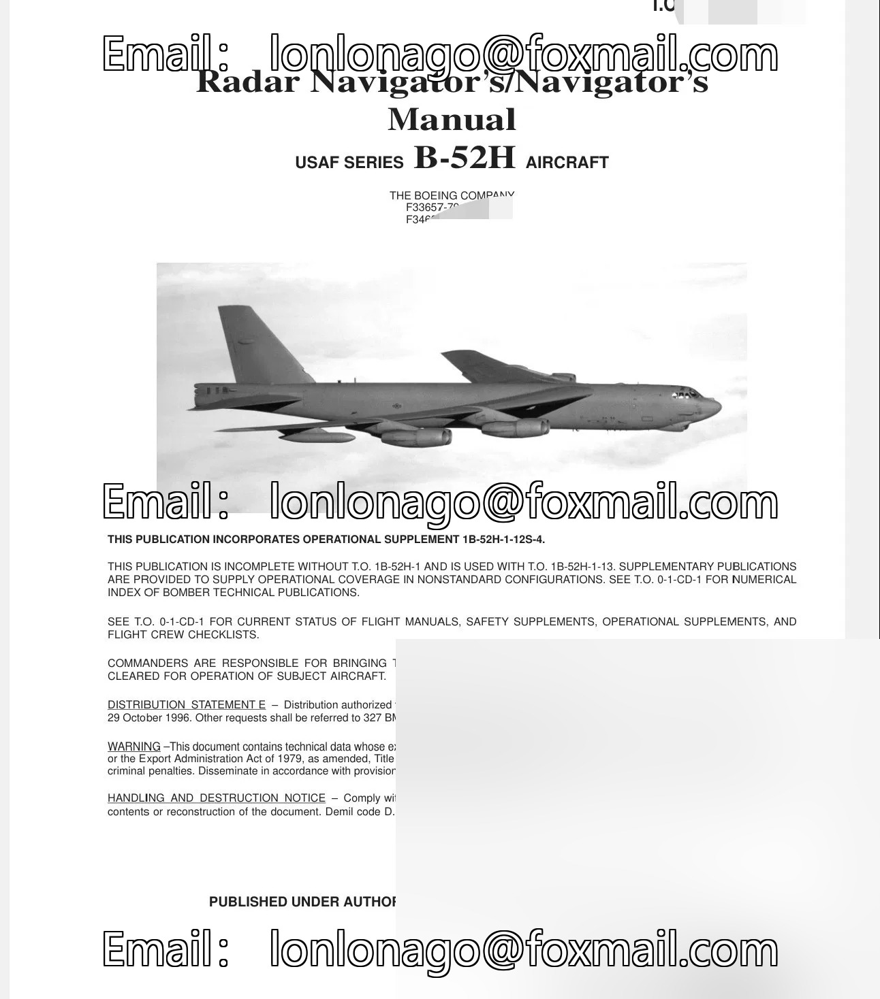
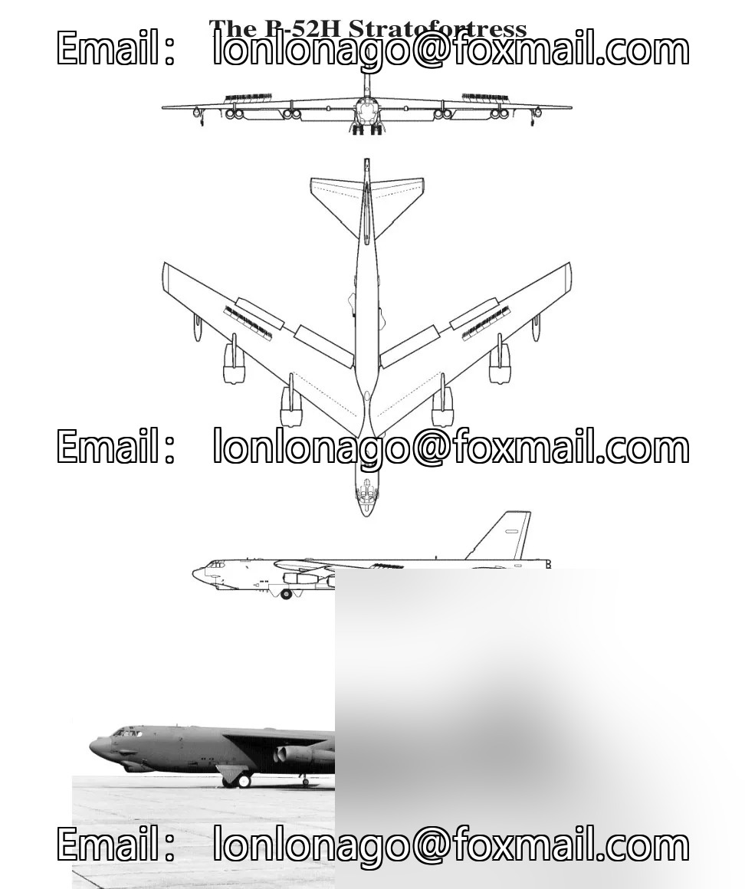
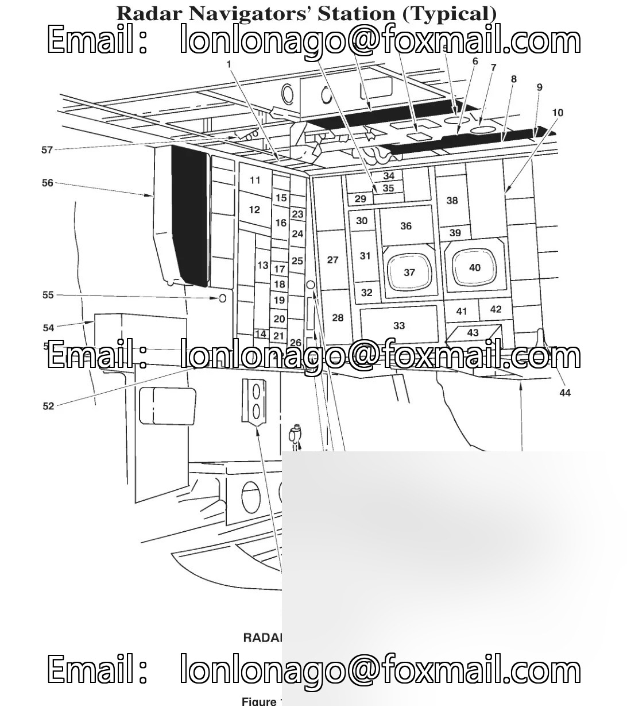
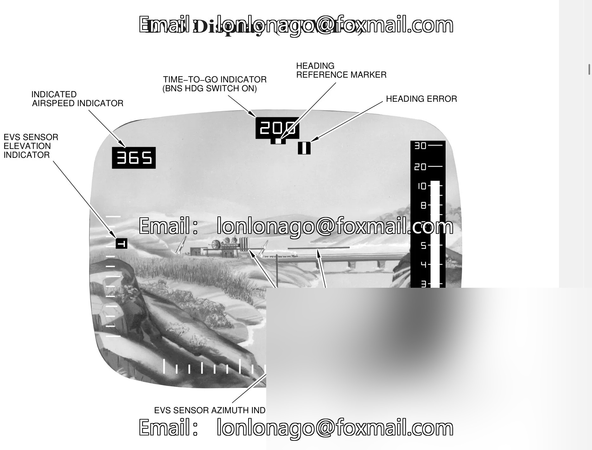

# U.S. Air Force B-52H "Thermosphere Fortress" strategic bomber radar navigator/navigator

## Body

The radar navigation technology manual of the US Air Force B-52H "Tomb of the Same Temperature Layer" strategic bombing aircraft.
Approximately 700 pages.
This is a strictly controlled confidential military technical document intended to provide professional and accurate operation guidance for the navigation crew of the B-52H bombing aircraft, ensuring the standardization and safety of mission execution.

This is a US Air Force B-52H “Same Temperature Zone” strategic bombing plane radar navigator technical manual, approximately 700 pages, featuring various navigational content, displays, and index information.

<!-- AI_ENRICHED -->

## Images

## Payment

Here is a pay link on Stripe ( https://buy.stripe.com/3cs8yP7sY87d0vu9AB ). Please contact me lonlonago@foxmail.com after funding $89, and I will send you a complete data files , thank you!

